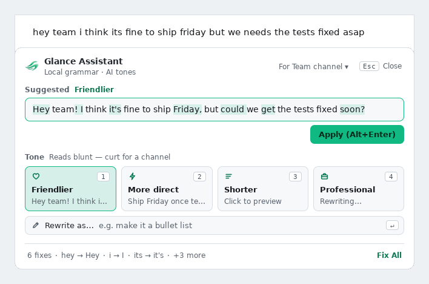
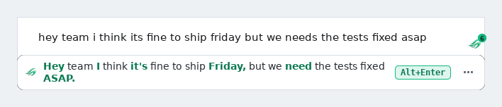
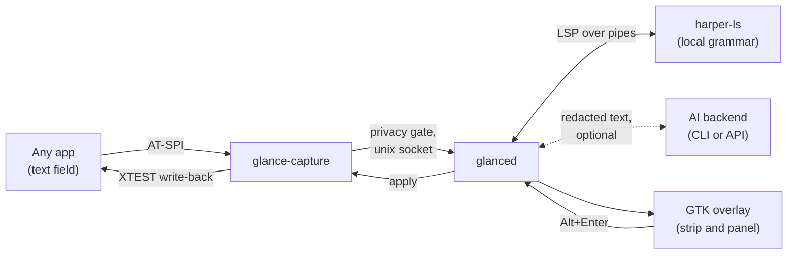

<div align="center">

<picture>
  <source media="(prefers-color-scheme: dark)" srcset="docs/assets/brand/glance-logo-on-dark.png">
  
</picture>

**A writing assistant for your whole desktop: Linux (X11 and GNOME Wayland) and macOS.**<br>
Fix spelling and grammar in any app. Offline, no AI needed.

[](LICENSE)
[](#install)
[](pyproject.toml)
[](#status-and-known-limits)

<br>

<picture>
  <source media="(prefers-color-scheme: dark)" srcset="docs/assets/screenshots/panel-dark.png">
  
</picture>

</div>

## What it does

- **Fixes spelling and grammar in any app.** Chat, mail in the browser, editors, terminals. Grammar runs on your computer.
- **Changes the tone.** Friendlier, more direct, shorter, more professional, or "Rewrite as…" (needs an AI).
- **Works on selected text.** Select text anywhere, then Explain, Summarize, Translate, Reply or Rewrite it.
- **Glance Shot.** Pick a screen region, then copy it, save it, pull the text out of it, or ask the AI to explain it.
- **Your AI, or none.** Use the `claude`, `codex`, `gemini` or `opencode` you already signed in to, or an API key. Grammar works offline without any.
- **Private by design.** Text goes to an AI only if you connect one, and secrets are removed first.

## Install

```sh
curl -fsSL https://raw.githubusercontent.com/Btocode/glance/main/install.sh | bash
```

Works on Linux (x86_64) and macOS 13 or later (Apple silicon and Intel). On Linux you need X11, or GNOME Shell 46 to 50 on Wayland. KDE, Sway and other Wayland desktops are not supported yet.

**One-time setup after installing:**

| Your system | What to do |
| --- | --- |
| Linux, X11 | Nothing. If `glance doctor` asks you to restart Chrome, Slack or similar, do it. |
| Linux, GNOME Wayland | Log out and back in once, so GNOME loads Glance's extension. |
| macOS | When macOS asks, switch on Accessibility for `python3.12` (System Settings → Privacy & Security → Accessibility). Screen Recording is needed only for Glance Shot. |

### Connect an AI

Optional. Grammar fixes work without it. Tones, rewrites, Explain and Translate need one.

1. Log in with the tool you like: `claude`, `codex login`, `gemini`, or `opencode auth login`. Or store an API key with `glance backend set-key`.
2. Glance picks a connected one automatically. Check with `glance backend list`, switch with `glance backend use NAME`, try with `glance backend test`.

Claude is the best tested. Codex, Gemini and OpenCode are experimental.

## How to use

1. Type in any text field. A small Glance icon appears at the end of the line.
2. Press <kbd>Super</kbd>+<kbd>Alt</kbd>+<kbd>G</kbd> (⌃⌥G on a Mac) to check. The corrected text shows in a strip under the field.
3. Press <kbd>Alt</kbd>+<kbd>Enter</kbd> to put it in. One <kbd>Ctrl</kbd>+<kbd>Z</kbd> undoes it. Plain <kbd>Enter</kbd> is never taken.
4. Rest the pointer on the icon, or right-click it, for tones (Friendlier, Direct, Shorter, Professional) and "Rewrite…".
5. Select text in any app and click the Glance mark that appears: Explain, Translate and more.
6. Press <kbd>Super</kbd>+<kbd>Alt</kbd>+<kbd>C</kbd> (⌃⌥C) for Glance Shot.
7. Tray or menu bar icon → **Features** switches things on and off, including checking as you type.

<picture>
  <source media="(prefers-color-scheme: dark)" srcset="docs/assets/screenshots/strip-dark.png">
  
</picture>

### Shortcuts

| Linux | macOS | What it does |
| --- | --- | --- |
| <kbd>Super</kbd>+<kbd>Alt</kbd>+<kbd>G</kbd> | ⌃⌥G | Check the field now |
| <kbd>Alt</kbd>+<kbd>Enter</kbd> | ⌥⏎ | Use the suggestion (or the tone you picked) |
| <kbd>Super</kbd>+<kbd>Alt</kbd>+<kbd>Space</kbd> | ⌃⌥O | Open the panel: tones, "Rewrite as…", list of fixes |
| <kbd>Super</kbd>+<kbd>Alt</kbd>+<kbd>1</kbd> … <kbd>4</kbd> | ⌃⌥1 … ⌃⌥4 | Pick tone 1 to 4 |
| <kbd>Super</kbd>+<kbd>Alt</kbd>+<kbd>F</kbd> | ⌃⌥F | Fix all safe grammar |
| <kbd>Super</kbd>+<kbd>Alt</kbd>+<kbd>Z</kbd> | ⌃⌥Z | Undo the last Glance change |
| <kbd>Super</kbd>+<kbd>Alt</kbd>+<kbd>A</kbd> | ⌃⌥A | Act on the selected text |
| <kbd>Super</kbd>+<kbd>Alt</kbd>+<kbd>C</kbd> | ⌃⌥C | Glance Shot (in the picker: Enter is the whole screen, Space the window, Esc cancels) |
| <kbd>Super</kbd>+<kbd>Alt</kbd>+<kbd>Enter</kbd> | ⌃⌥⏎ | Ask for a completion (shown as ghost text, <kbd>Tab</kbd> takes it) |
| <kbd>Super</kbd>+<kbd>Alt</kbd>+<kbd>P</kbd> | ⌃⌥P | Pause or resume |
| <kbd>Esc</kbd> | Esc | Close the strip and the panel |

The tray's **Keyboard shortcuts…** shows them as set on your computer. Change any in `[general.hotkeys]`. None clashes with a desktop shortcut; see [docs/shortcuts.md](docs/shortcuts.md).

## Update and uninstall

```sh
glance update                                  # same installer; keeps your config, keys and dictionary
~/.local/share/glance-src/uninstall.sh         # remove Glance (--keep-data keeps your dictionary)
```

`glance update --check` only says whether a newer version exists. Glance also checks once a day and adds "Update now" to the tray menu.

Uninstall keeps `~/.config/glance/config.toml`. It leaves the accessibility setting on: on GNOME turn it off with `gsettings set org.gnome.desktop.interface toolkit-accessibility false`, on macOS remove the Accessibility entry in System Settings.

## Troubleshooting

Start with `glance doctor`. It checks everything and says what to do. `glance doctor --fix` repairs what Glance owns. `glance status` shows what Glance is doing (never your text).

| Problem | Fix |
| --- | --- |
| Nothing happens | Run `glance doctor --fix`. |
| "Connect an AI" | Log in to `claude` (or another AI, see above). Grammar still works. |
| No icon on GNOME Wayland | Log out and back in once. |
| macOS: no icon or suggestions | Switch on Accessibility for `python3.12`, then `launchctl kickstart -k gui/$(id -u)/io.github.btocode.glance`. |
| The first check is slow | The AI is starting up. Later checks are faster. |
| A shortcut does nothing | Another program may own it. `glance doctor` reports clashes. Change it in `[general.hotkeys]`. |

Logs (they never contain your text): Linux `journalctl --user -u glance`, macOS `~/Library/Logs/Glance/glanced.log`.

## More

<details>
<summary><b>Settings</b></summary>

<br>

Settings live in `~/.config/glance/config.toml`. Glance reads changes while it runs.

```toml
[general]
check = "shortcut"            # or "typing": check as you type
check_updates = true          # false: never look for a newer version

[general.hotkeys]             # only the keys you set change
check = "Super+Alt+g"

[ui]
suggestions = "on_click"      # or "auto" (typing mode): show suggestions by themselves
use_key = "Alt+Return"        # the key that puts the suggestion in

[ai]
max_words = 600               # most words the AI reads at once (50-5000)
monthly_cost_limit_usd = 5.00 # stop AI calls at this reported cost (default: no limit)

[selection]
enabled = true                # the floating mark beside selected text
translate_to = "English"

[shot]
enabled = true
save_dir = "~/Pictures/Glance"
ocr = "auto"                  # auto, ocrs, tesseract or off
ai_images = "ask"             # ask, allow or never (Explain / Ask send the image to the AI)

[backend]
warm = false                  # no idle claude process (default on, about 195 MB each)

[apps.slack]                  # per app, by window class
capture = false               # stop automatic field capture in this app
```

Change a model with `glance backend model NAME MODEL`. Defaults are each tool's fastest, cheapest model. To make Glance never read an app, add its window class to `privacy.app_denylist` (this replaces the built-in list of password managers and remote-desktop tools).

**Other commands:** `glance pause [30m|2h]`, `glance resume`, `glance profile`, `glance features`, `glance rewrite --tone friendlier < draft.txt`, `glance usage`.

**Claude Code Ctrl+G (Linux):** `glance wrapper install` adds a `claude()` function to `.zshrc` so Ctrl+G opens your prompt in Glance's editor. `glance wrapper uninstall` removes it.

**Installer options:** add them after `bash -s --`. `--with-apt` installs missing system packages with one `sudo apt-get install -y` (never run otherwise), `--yes` / `--no-wrapper` answer the Claude Code wrapper question, `--no-desktop-overrides` leaves Chrome, Brave, Slack and Discord launchers alone, `--no-start` does not start the service, `--from-local` installs from a checkout. For the Linux tray icon install `gir1.2-ayatanaappindicator3-0.1`; without it Glance works with no icon.

</details>

<details>
<summary><b>Privacy</b></summary>

<br>

- Grammar checks run on your computer ([Harper](https://github.com/Automattic/harper)). Nothing is sent to an AI until you connect one.
- Text sent to any backend is redacted first (keys, tokens, cards, private keys).
- An API key lives in the system keyring (Keychain on macOS) only, never in the config or logs.
- `glance status` and the logs never contain your text.
- Once a day Glance asks github.com for the latest version; nothing else is sent. Turn it off with `check_updates = false`.
- A Glance Shot image stays in memory. It is written to disk only if you click Save, and sent to an AI only by Explain or Ask, after a notice.
- Private browser windows, password managers and banking or SSO pages are never read.
- On GNOME Wayland, Glance's shell extension can type into the focused window and read the clipboard. It serves only Glance's own processes.

Found a privacy leak? Report it privately: see [SECURITY.md](SECURITY.md).

</details>

<details>
<summary><b>AI usage tracking</b></summary>

<br>

Glance counts its own AI calls per day, backend and model: calls, failures, tokens and what each was for. No text is stored, only numbers, in `~/.local/share/glance/usage-ledger.json` (last 90 days). Figures appear only where the backend reports them; Glance never estimates, so a missing figure shows as `n/a`.

See it with `glance usage` (`--days N`, `--json`), `glance status`, or the tray's "AI usage" menu. With `monthly_cost_limit_usd` set, Glance refuses new AI calls once the reported cost reaches it (local grammar keeps working) and starts again on the 1st. Only backends that report a cost, such as claude, are limited.

</details>

<details>
<summary><b>How it works</b></summary>

<br>



- **`glance-capture`** follows the focused field over AT-SPI. A privacy gate decides from the field's metadata alone (app, window, URL, role), never its text, whether the text may leave capture.
- **`glanced`** is the daemon: scheduling, Harper, the overlay, hotkeys and the tray in one loop. It restarts `glance-capture` and `harper-ls` if they die.
- **Write-back** types one edit into the field (or pastes it), checks it landed, and undoes it if not.
- **GNOME Wayland:** Wayland blocks overlays, global shortcuts and typing into other apps, so a small GNOME Shell extension (`glance@btocode.github.io`) does just those parts. The installer enables it; you log out and in once.
- **macOS:** the same design through the Accessibility API, with a LaunchAgent. The installer needs no `sudo`, Homebrew or Xcode.

</details>

<details>
<summary><b>Status and known limits</b></summary>

<br>

Glance is early software, tested by automated tests (a private Xvfb on X11, a headless GNOME Shell on Wayland, a test app on a Mac), not yet in daily use on real desktops.

- Not run yet: the live desktop checklist (real Slack, Discord, Gmail, claude.ai, ChatGPT) and the suspend, lock and monitor-hotplug check.
- Firefox write-back is not matrix-tested. Flatpak and snap apps are not captured.
- Codex, Gemini and OpenCode are experimental; Gemini and OpenCode never returned a verified reply in testing.
- Tested on Ubuntu 22.04 / Python 3.10 (X11) and Ubuntu 26.04 / Python 3.14 with GNOME Shell 50 (Wayland). x86_64 only. GNOME 46 to 49 are supported but untested.
- macOS: tested on macOS 15 (Apple silicon) with a test app only. Safari, Chrome, Arc and Electron apps are expected to work but are untested. Safari private windows cannot be detected. The Accessibility grant is on the Python interpreter, so a Python update may ask again. The Ctrl+G editor window and the "Connect an AI" window are not ported yet; use `glance backend`.
- Details: [docs/acceptance/report.md](docs/acceptance/report.md).

</details>

## Contributing

Bug reports, fixes and new backends are welcome. Start with [CONTRIBUTING.md](CONTRIBUTING.md). Please follow the [Code of Conduct](CODE_OF_CONDUCT.md).

## License

[MIT](LICENSE) © 2026 Btocode
