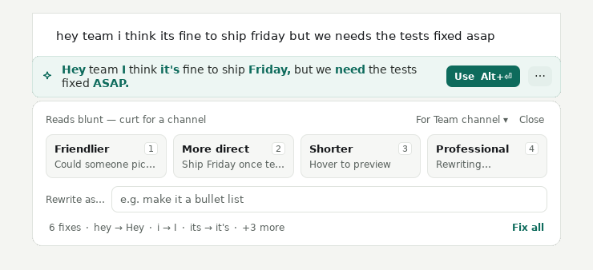
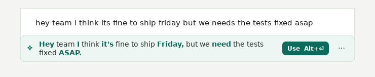
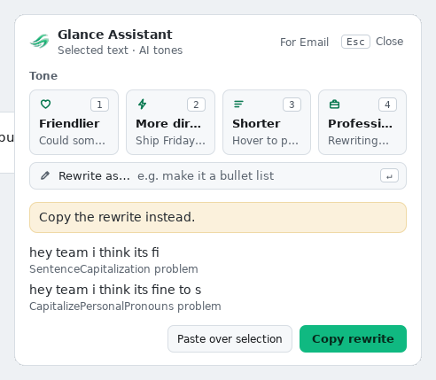
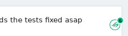
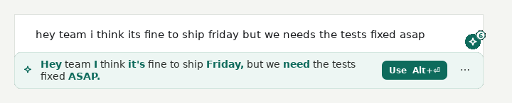
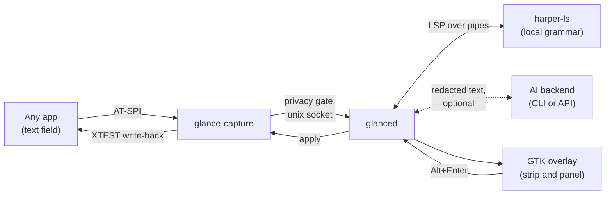

<div align="center">

<picture>
  <source media="(prefers-color-scheme: dark)" srcset="docs/assets/brand/glance-logo-on-dark.png">
  
</picture>

**A system-wide writing assistant for Linux: X11, and GNOME on Wayland.**<br>
Offline grammar fixes, in place, in any app. No AI required.

[](LICENSE)
[](#requirements)
[](pyproject.toml)
[](#status-and-known-limits)

[Install](#install) ·
[macOS](#macos) ·
[Connect an AI](#connect-an-ai) ·
[Usage](#usage) ·
[Settings](#settings) ·
[How it works](#how-it-works) ·
[Privacy](#privacy) ·
[Contributing](CONTRIBUTING.md)

<br>

<picture>
  <source media="(prefers-color-scheme: dark)" srcset="docs/assets/screenshots/strip-expanded-dark.png">
  
</picture>

</div>

## Why Glance

Most writing assistants live inside one browser tab or one editor. Glance lives in your desktop:
it follows the text field you are typing in (a chat app, a mail client in the browser, a GTK
editor, Claude Code in a terminal) and quietly shows the corrected text right under it.

- **Local first.** Grammar runs on your computer through [Harper](https://github.com/Automattic/harper)
  (`harper-ls`). Text goes to an AI only if you connect one.
- **Never in the way.** A quiet strip, not a popup. Plain <kbd>Enter</kbd> is never taken, so chat
  apps still send.
- **Bring your own AI.** Tone hints and rewrites use the `claude`, `codex`, `gemini` or `opencode`
  CLI you already signed in to, or an API key kept in the system keyring.
- **Undoable.** An accepted fix goes in as one <kbd>Ctrl</kbd>+<kbd>Z</kbd> step.

## Features

<table>
<tr>
<td width="50%" valign="top">

**Check on a shortcut**<br>
Glance stays quiet while you type. Press <kbd>Super</kbd>+<kbd>Alt</kbd>+<kbd>G</kbd> (⌃⌥G on a
Mac) or click the Glance icon: a strip under the field shows the whole message corrected.
<kbd>Alt</kbd>+<kbd>Enter</kbd> (or its **Use** button) puts the corrected text in. Prefer
checks as you type? Switch to **Check: while typing** in the tray menu.

</td>
<td width="50%">

<picture>
  <source media="(prefers-color-scheme: dark)" srcset="docs/assets/screenshots/strip-collapsed-dark.png">
  
</picture>

</td>
</tr>
<tr>
<td valign="top">

**Tone and rewrites**<br>
"⋯" (or <kbd>Super</kbd>+<kbd>Alt</kbd>+<kbd>Space</kbd>) opens the tone rewrites,
"Rewrite as…" and the list of fixes. The tone chips follow the audience profile of the field
you are in. Needs a connected AI.

</td>
<td>

<picture>
  <source media="(prefers-color-scheme: dark)" srcset="docs/assets/screenshots/strip-expanded-dark.png">
  
</picture>

</td>
</tr>
<tr>
<td valign="top">

**Select anything**<br>
<kbd>Super</kbd>+<kbd>Alt</kbd>+<kbd>A</kbd> rewrites the text you have selected in any app.
Copy is the default; "Paste over selection" is optional and absent in terminals.

</td>
<td>



</td>
</tr>
</table>

Also: ghost-text autocomplete, a Ctrl+G editor window for [Claude Code](#claude-code-ctrlg), a
tray icon, and `glance doctor`, which checks everything and fixes what Glance owns.

## Install

```sh
curl -fsSL https://raw.githubusercontent.com/Btocode/glance/main/install.sh | bash
```

Afterwards run `glance doctor`, and [connect an AI](#connect-an-ai) if you want rewrites and tone
help. Grammar fixes work without one.

### Requirements

- On **x86_64**, either an X11 session ("Ubuntu on Xorg"), or **GNOME Shell 46 to 50 on
  Wayland** (Ubuntu's default session). KDE Plasma, Sway and other Wayland desktops are not
  supported yet; the installer says so and stops.
- A running systemd user manager.
- The system Python (`/usr/bin/python3`, 3.10 to 3.14) with GTK 3, AT-SPI and Wnck.

If a system package is missing the installer prints the exact `sudo apt install …` line and
stops; it never runs `sudo` itself unless you pass `--with-apt`:

```sh
curl -fsSL https://raw.githubusercontent.com/Btocode/glance/main/install.sh | bash -s -- --with-apt
```

`--with-apt` runs one `sudo apt-get install -y` with a fixed list: the missing packages it just
listed plus the tray icon library. It echoes the command first and does not run `apt-get
update`. On a system without `apt-get` it stops and names the packages to install another way.

For the tray icon install `sudo apt install gir1.2-ayatanaappindicator3-0.1`; without it Glance
runs the same, with no icon.

<details>
<summary><b>What the installer does</b></summary>

<br>

1. Clones Glance into `~/.local/share/glance-src` (a re-run updates it with `git pull --ff-only`)
   and builds a venv there.
2. Downloads the grammar engine `harper-ls` (SHA-256 pinned).
3. Links `glance`, `glanced`, `glance-capture` and `glance-edit` into `~/.local/bin`. Existing
   files there that are not Glance's are never overwritten.
4. Installs and starts the systemd user unit `glance.service`.
5. Runs `glance doctor --fix` and prints the result. If `glance doctor --fix` crashes the
   installer stops with its error; if some checks are only still red it finishes and tells you
   to run `glance doctor`.
6. When the `claude` CLI is installed and your login shell is zsh, it asks before adding the
   `claude` Ctrl+G wrapper to `.zshrc` (no terminal means no). It never changes `$EDITOR`.

On GNOME Wayland it also installs Glance's GNOME Shell extension (see
[GNOME on Wayland](#gnome-on-wayland)) and asks you to log out and in once.

Running it again is safe.

</details>

<details>
<summary><b>Installer options</b></summary>

<br>

| Option | Effect |
| --- | --- |
| `--with-apt` | install missing system packages with one `sudo apt-get install -y` |
| `--yes` | accept the Claude Code wrapper |
| `--no-wrapper` | do not add the Claude Code wrapper |
| `--no-desktop-overrides` | leave the Chrome/Brave/Slack/Discord launchers alone |
| `--no-start` | do not start the service |
| `--from-local` | install from a checkout: `./install.sh --from-local` |

</details>

### Updating

Re-run the install line above, or run `glance update` (it runs that same installer). Your config,
dictionary, API keys and the Ctrl+G wrapper are kept. `glance update --check` only says whether a
newer version exists (exit 10 if so). Glance also checks once a day and, when an update is
available, adds "Update available — Update now" to the tray menu.

### Doctor

`glance doctor` checks the session, system packages, grammar engine, daemon, hotkeys, app
launcher flags, AI backend, Ctrl+G wrapper and autostart, and says what to do about each
problem.

| Command | Does |
| --- | --- |
| `glance doctor` | runs the checks, each with what to do next |
| `glance doctor --fix` | repairs what Glance owns |
| `glance doctor --fix --skip ID` | leaves one check alone |
| `glance doctor --fix --app ID` | opts another Chromium/Electron app in |
| `glance doctor --undo` | takes those changes out again |

### Uninstall

```sh
~/.local/share/glance-src/uninstall.sh          # or ./uninstall.sh in your checkout
```

Stops and removes the unit, undoes what `glance doctor --fix` set up for launchers and the
`claude` block in `.zshrc` (byte for byte), removes Glance's symlinks, its data in
`~/.local/share/glance` and the source it cloned. `--keep-data` keeps your personal dictionary
and ignored rules. `~/.config/glance/config.toml` is always kept. It is safe to run twice.

> [!NOTE]
> Uninstall leaves GNOME's toolkit-accessibility setting on (`glance doctor --fix` turned it on).
> Turn it off yourself with
> `gsettings set org.gnome.desktop.interface toolkit-accessibility false`.

<details>
<summary><b>If the uninstaller cannot undo everything</b></summary>

<br>

If the undo cannot run (Glance's environment is broken, even through the system Python), it
keeps `~/.local/share/glance/desktop-overrides.json`, the install record and the source, lists
the launcher files and `.zshrc` block still in place, and exits non-zero: re-run the installer
and then the uninstaller, or remove the listed files by hand.

</details>

## macOS

Glance also runs on **macOS 13 or later** (Apple silicon and Intel). The same install line
works: on a Mac `install.sh` hands off to `scripts/install-macos.sh`.

```sh
curl -fsSL https://raw.githubusercontent.com/Btocode/glance/main/install.sh | bash
```

It needs no `sudo`, no Homebrew and no Xcode, and changes no shell file. It installs
[uv](https://docs.astral.sh/uv/) under `~/.local/share/glance/uv` when uv is not already on
your `PATH`, a uv-managed CPython 3.12 under `~/.local/share/glance/python` (never Apple's 3.9
or Homebrew's), a venv with PyObjC, the pinned `harper-ls` for your CPU, links the commands into
`~/.local/bin`, and a LaunchAgent (`~/Library/LaunchAgents/io.github.btocode.glance.plist`)
that starts Glance at login and restarts it after a crash. Logs go to
`~/Library/Logs/Glance/glanced.log`. Settings and data use the same paths as on Linux
(`~/.config/glance/config.toml`, `~/.local/share/glance`); API keys go in your login Keychain.

**The one-time Accessibility grant.** Glance reads and writes text fields through the macOS
Accessibility API, which needs your permission once. The installer and `glance doctor` print the
exact file to allow, for example
`~/.local/share/glance/python/cpython-3.12.…-macos-aarch64-none/bin/python3.12`:

1. System Settings → Privacy & Security → Accessibility → **+**.
2. Press ⌘⇧G, paste the path, choose the file, and switch it on.
3. Restart Glance: `launchctl kickstart -k gui/$(id -u)/io.github.btocode.glance`.

`glance doctor --fix` opens that pane and shows macOS's own prompt. Input Monitoring is not
needed. Glance lives in the menu bar (✦) with the same menu as the Linux tray.

**Hotkeys on a Mac.** `Super` in `config.toml` means ⌘, `Alt` ⌥, `Ctrl` ⌃. Because ⌘⌥
chords clash with app shortcuts, the defaults on macOS are ⌃⌥ chords:

| Action | macOS |
| --- | --- |
| Check the field now (opens the strip) | ⌃⌥G |
| Open the strip and drawer | ⌃⌥O |
| Use the suggestion (while the strip shows) | ⌥⏎ |
| Fix all | ⌃⌥F |
| Undo the last fix | ⌃⌥Z |
| Pause / resume | ⌃⌥P |
| Tone 1–4 | ⌃⌥1 … ⌃⌥4 |
| Complete (autocomplete) | ⌃⌥⏎ |
| Select-anything | ⌃⌥A |

A chord you changed in `[general.hotkeys]` is used as you wrote it. Shortcuts macOS itself
owns are left alone and reported. The panel moved from ⌃⌥G to ⌃⌥O in this release so that
⌃⌥G checks, as <kbd>Super</kbd>+<kbd>Alt</kbd>+<kbd>G</kbd> does on Linux. VoiceOver takes every
⌃⌥ chord while it runs; see [docs/shortcuts.md](docs/shortcuts.md).

**Uninstall** with `~/.local/share/glance-src/uninstall.sh` (or `./uninstall.sh` in a checkout):
it stops and removes the LaunchAgent, the links, the environment, the grammar engine, the logs
and the source it downloaded, exactly as recorded at install. Remove the Accessibility entry
yourself in System Settings.

**Limits on macOS (first release):**

- Developed on macOS 15.6 (Apple silicon) against a native AppKit test app; Safari, Chrome, Arc and
  Electron apps are expected to work (their trees are switched on) but are not yet tested.
- Safari's private windows carry no marker Glance can see: Safari is gated by URL and the deny
  lists only. Chrome, Brave and Arc incognito windows are recognised by their title.
- macOS cannot offer a paste to one app only; Glance's clipboard writes are marked concealed
  and transient so clipboard managers skip them, and the clipboard is restored afterwards.
- The Ctrl+G editor window and the "Connect an AI" window are not ported yet: use
  `glance backend …` in Terminal or the menu bar's AI backend menu.
- The Accessibility grant is on the Python interpreter (there is no signed app bundle yet);
  a Python update by the installer may ask for the grant again.

## Connect an AI

Grammar checks run on your computer. Tone hints and rewrites need one AI that **you** choose;
until one is connected the chip, the tray and `glance doctor` all say "Connect an AI" and the
grammar checks keep working. Sign in with the vendor's own tool, then choose it:

| AI | Connect | Default model |
| --- | --- | --- |
| Claude | run `claude` and log in | `haiku` |
| Codex *(experimental)* | `codex login` | `gpt-6-luna` |
| Gemini *(experimental)* | run `gemini` to authenticate (or use an API key) | `flash-lite` |
| OpenCode *(experimental)* | `opencode auth login` | OpenCode's own default |
| API key | `glance backend set-key` (stored in the system keyring only) | Anthropic: `claude-haiku-5-5`; OpenAI-compatible: whatever you set |

```sh
glance backend list            # what is connected, the model each uses, the command for the rest
glance backend use NAME        # choose one (exit 2, with its sign-in command, when not connected)
glance backend test [NAME]     # one real call with a short sample sentence
```

The onboarding window (tray menu: **AI backend, Set up...**) does the same with buttons: Copy
the command, Test, Use this, and API provider, model, base URL and key.

<details>
<summary><b>Models and speed</b></summary>

<br>

Glance only does short, basic text work, so each backend defaults to its fastest, cheapest
model (see the table). Change it with `glance backend model NAME MODEL` (e.g.
`glance backend model codex gpt-6-luna`; for `api` it sets `backend.api_model`) and go back with
`glance backend model NAME --default`; the same lives in `[backend.models]` of the config. A
model the tool rejects is retried once with the tool's own default.

</details>

<details>
<summary><b>Warm claude</b></summary>

<br>

With claude chosen, Glance keeps a claude process started and idle, so a call skips ~0.9 s of
start-up. It costs about 195 MB of memory per idle process (one for checks, one for rewrites:
up to ~390 MB). Set `warm = false` under `[backend]` in the config to turn it off (`true` or
leaving it out: on). It is never on for another backend, and it is shut down when you switch
away from claude, change claude's model or set `warm = false`.

</details>

> [!IMPORTANT]
> The provider processes your text under its own terms; the onboarding window says what each
> tool may keep despite Glance's no-session flags. Text sent to any backend is redacted first
> (keys, tokens, cards, private keys).

Codex and OpenCode run with their shell, file and web tools switched off through flags and a
deny-all permission config, but that lock-down could not be confirmed without a billed model
call, so both are marked experimental in `glance doctor`.

## Usage

Glance runs as a systemd user service. Type in any text field: a small Glance icon at the end of
the line shows that Glance is ready. When you want your text checked, press
<kbd>Super</kbd>+<kbd>Alt</kbd>+<kbd>G</kbd> (⌃⌥G on a Mac) or click the icon. The icon shows the
check working, then the suggestion strip opens with the corrected text. Rest the pointer on the
icon for a menu: check spelling and grammar, check the tone, rewrite, make it shorter or more
professional.

**Two ways to check**, set from the tray menu (**Check: on shortcut / while typing**) or in
`config.toml`:

```toml
[general]
check = "shortcut"   # default: nothing is checked or sent to an AI until you press the
                     # check shortcut or click the icon
# check = "typing"   # check as you type; the icon shows the fixes it found as you go
```

In the default **shortcut** mode, Glance runs no grammar checks, AI analysis or speculative AI
calls while you type. The capture helper still reads the focused field (to place the icon and
to verify a fix it types in), but nothing is checked until you ask. If you edit the text after
a check, the strip closes and the icon goes back to "ready". Press the shortcut again to check
the new text. Pressing it while the strip is open checks again. <kbd>Esc</kbd> or moving to
another field closes the strip. **Typing** mode is how Glance worked before: it checks after each pause
(see [Status icon and when suggestions appear](#status-icon-and-when-suggestions-appear)).

<p align="center">
<picture>
  <source media="(prefers-color-scheme: dark)" srcset="docs/assets/screenshots/status-ready-dark.png">
  
</picture>
&nbsp;&nbsp;
<picture>
  <source media="(prefers-color-scheme: dark)" srcset="docs/assets/screenshots/status-strip-dark.png">
  
</picture>
</p>

None of these is a GNOME, Ubuntu, KDE, Xfce or macOS system shortcut;
[docs/shortcuts.md](docs/shortcuts.md) lists what was checked.

| Linux | macOS | Action |
| --- | --- | --- |
| <kbd>Super</kbd>+<kbd>Alt</kbd>+<kbd>G</kbd> | ⌃⌥G | check the field now and open the strip (again: check again) |
| <kbd>Alt</kbd>+<kbd>Enter</kbd> | ⌥⏎ | put the corrected text in (only grabbed while the strip shows a fix) |
| <kbd>Super</kbd>+<kbd>Alt</kbd>+<kbd>Space</kbd> | ⌃⌥O | open the panel: tone rewrites, "Rewrite as…", the list of fixes |
| <kbd>Super</kbd>+<kbd>Alt</kbd>+<kbd>F</kbd> | ⌃⌥F | fix all safe grammar |
| <kbd>Super</kbd>+<kbd>Alt</kbd>+<kbd>Z</kbd> | ⌃⌥Z | revert the last change |
| <kbd>Super</kbd>+<kbd>Alt</kbd>+<kbd>P</kbd> | ⌃⌥P | pause |
| <kbd>Super</kbd>+<kbd>Alt</kbd>+<kbd>1</kbd> … <kbd>4</kbd> | ⌃⌥1 … ⌃⌥4 | apply the Nth tone chip of the field's audience |
| <kbd>Super</kbd>+<kbd>Alt</kbd>+<kbd>Enter</kbd> | ⌃⌥⏎ | ask for a completion (ghost text) |
| <kbd>Super</kbd>+<kbd>Alt</kbd>+<kbd>A</kbd> | ⌃⌥A | rewrite the selected text in any app |
| <kbd>Esc</kbd> | Esc | close the strip and the panel |

Plain <kbd>Enter</kbd> is never taken, so it still sends in chat apps.

### Command line

```sh
glance status                    # what it is doing (never any text); --json for scripts
glance pause [30m|2h|45s]        # switch checking off (no duration: until resumed)
glance resume                    # and on again
glance rewrite --tone friendlier < draft.txt   # stdin to stdout through the chosen AI
glance profile [show|set NAME|clear]           # the audience profile of the field you are in
glance update [--check]          # update Glance; --check only compares versions
```

`status`, `pause` and `resume` print `glanced is not running` and exit 3 when the daemon is
down. `glance rewrite` exits 4 when no AI is connected.

### Claude Code Ctrl+G

`glance wrapper install` adds a marked `claude()` function to `${ZDOTDIR:-$HOME}/.zshrc`. It sets
`EDITOR`/`VISUAL=glance-edit` for the `claude` process only (the previous editor is kept in
`GLANCE_REAL_EDITOR`); your shell's own `$EDITOR` never changes. <kbd>Ctrl</kbd>+<kbd>G</kbd> in
Claude Code then opens your prompt in Glance's editor window.

- `glance wrapper uninstall` removes the block exactly.
- `glance wrapper status` prints `installed`, `absent` or `conflict`.
- `glance-edit` must be on the PATH of new shells (for example `~/.local/bin`).

## AI usage

Glance keeps a count of its own AI calls so you can see what it uses. After every call it adds
to one entry per day, backend and model: calls, failed calls, input and output tokens, and
what each call was for (analyze, rewrite, complete, sharpen). **No text is stored**: no
prompts, no replies, no field contents, only numbers. The ledger is
`~/.local/share/glance/usage-ledger.json` (mode 0600, the last 90 days).

Tokens and cost are recorded only where the backend reports them: claude reports both
(cost as `total_cost_usd`), the `api` backend and codex report tokens, gemini and opencode
report neither. Glance has no price list and never estimates, so a missing figure shows as
`n/a`. On a subscription (a CLI you signed in to) the cost is the API-equivalent figure the
CLI reports; you are not billed per call.

Where to see it:

- `glance usage` prints Today, Last 7 days and This month per backend and model, plus today's
  calls against your daily and per-minute limits. `--days N` shows the last N days;
  `--json` prints the numbers.
- `glance status` has a short `usage_today` (calls, tokens, cost, calls left today).
- The tray has an "AI usage" submenu (Today, This month) and "Details..." for the full table.

To stop AI calls once a month's reported cost reaches a number of US dollars, set it in
`~/.config/glance/config.toml`:

```toml
[ai]
monthly_cost_limit_usd = 5.00   # default: no limit
```

When the limit is reached Glance refuses new AI calls (the chip and tray say "Monthly AI cost
limit reached") and the local grammar and spelling checks keep working. It starts again on
the 1st of the next month, or when you raise or remove the setting. Only a cost a backend
reported counts, so it limits claude (and any backend that reports a cost), not the others.

## Settings

Settings live in `~/.config/glance/config.toml`; Glance picks up changes while it runs.

```toml
[general]
check_updates = true             # false: never look for a newer version
check = "shortcut"               # or "typing": when the text is checked (see Usage)

[general.hotkeys]               # only the keys you set change; the rest keep their defaults
check = "Super+Alt+g"
panel = "Super+Alt+space"
fix_all = "Super+Alt+f"

[ui]
use_key = "Alt+Return"          # the key that puts the strip's corrected text in

[ai]
max_words = 600                 # the most words the AI reads at once (50-5000)

[backend]
warm = false                    # no idle claude process

[backend.models]
claude = "haiku"

[apps.slack]                    # per app, by window class
capture = false                 # stop automatic field capture in this app
```

A shortcut that another program or GNOME itself already uses is left alone and reported in a
notification, in `glance status` and in `glance doctor` (which also reads GNOME's own shortcuts,
so it reports a clash even while glanced is not running). The defaults and the desktop shortcuts
they were checked against are in [docs/shortcuts.md](docs/shortcuts.md).

`[ai] max_words` caps how much of one text goes to the AI (analysis, rewrites and
select-anything). A longer text is still spell- and grammar-checked locally as a whole (up to
5,000 words), but the AI only gets the `max_words` words around your cursor, cut at sentence
or paragraph boundaries, and the strip says so ("Long text: AI checked 600 of 1,450 words
around your cursor"). A value outside 50-5000 is ignored with a warning in the log.

### Status icon and when suggestions appear

While you write in a text field, a small round Glance icon sits at the end of the line you are typing and shows what Glance is doing:

| Icon | Meaning |
|---|---|
| Plain outline | Watching this field, nothing to suggest (in shortcut mode: ready to check) |
| Ring (turns during an AI call) | Checking |
| Filled, with a number | That many fixes are ready (a dot instead of a number: a tone note) |
| Grey | Paused, a private field, or no AI connected (spelling and grammar fixes still work without one) |

Click the icon to see the corrected text (in shortcut mode the click checks first); click
again or press <kbd>Esc</kbd> to close it. Resting the pointer on the icon opens its menu
(not while you are typing): **Check spelling & grammar**, **Check tone**, **Rewrite…**,
**Shorter**, **More professional**, and the check shortcut. When Glance is paused, the field is
private or no AI is connected, the menu shows why and what to do instead (**Resume**,
**Connect an AI…**). <kbd>Super</kbd>+<kbd>Alt</kbd>+<kbd>Space</kbd> opens it with the rewrite options. In typing mode, to have the suggestion appear by itself instead, tick **Show suggestions automatically** in the tray menu, or set:

```toml
[ui]
suggestions = "auto"   # default "on_click": only after a click on the Glance icon
```

The suggestion covers the whole field, every sentence and paragraph, not just the one with the
cursor: it fixes spelling, grammar, punctuation and capitalisation in your own words (never a
rewording), the badge counts every fix, and **Use** replaces the whole text in one undo step.
A long message is shown compact, only the sentences with fixes separated by "…" and a line
like "7 fixes across the message"; **⋯** expands it to the whole corrected text.


## How it works



- **`glance-capture`** follows the focused field over AT-SPI. A hard privacy gate decides from
  the field's metadata alone (app, window class and title, URL, role and states), never its
  text, whether that text may leave capture.
- **`glanced`** is the daemon: scheduling, Harper, the overlay, hotkeys and the tray in one GTK
  main loop. It starts `glance-capture` and `harper-ls` itself and restarts them if they die.
- **Write-back** puts one edit into the focused field through synthetic keys (XTEST) or the
  clipboard, checks it landed, and undoes it if not. It never interleaves with your typing.

## Privacy

- Grammar checks run on your computer. Nothing is sent to an AI until you connect one.
- Text sent to any backend is redacted first (keys, tokens, cards, private keys).
- An API key lives in the system keyring (libsecret) only, never in the config or the logs.
- Once a day Glance asks github.com for the latest version (`git ls-remote`); nothing else is
  sent. Turn it off with `check_updates = false` under `[general]`.
- `glance status` and the logs never contain any of your text.
- On GNOME Wayland, Glance's shell extension can type into the focused window and read the
  clipboard and the selection, which Wayland keeps from ordinary apps. It serves only
  Glance: every call is refused unless the caller owns Glance's own bus name and the bus
  reports it as a `glanced` / `glance-capture` process of your user (only "is the extension
  there?" is open to all), and glanced in turn accepts calls only from GNOME Shell. What is
  left: another unsandboxed program running as you could start a fake `glanced`; such a
  program can already read your files and attach to your processes. Flatpak and snap apps
  cannot reach Glance's bus names unless their sandbox is given `--talk-name` for them.
- To make Glance never read an app, add its window class to `privacy.app_denylist` (setting the
  list replaces the built-in one, which already holds password managers and remote-desktop
  tools): that is the "never read" switch, and select-anything honours it, as it does private
  browser windows and banking/SSO pages. `[apps.NAME] capture = false` only stops automatic
  field capture; it does not stop an explicit select-anything request in that app.

Found a privacy leak? Please report it privately; see [SECURITY.md](SECURITY.md).

## GNOME on Wayland

Wayland does not let an ordinary app float a window over another app without taking the
focus, grab global shortcuts, type into another app or read where its windows are. On GNOME,
Glance therefore ships a small GNOME Shell extension, `glance@btocode.github.io`, that does
exactly those parts and nothing else: it draws the status icon, the strip and the drawer
inside the shell, binds the hotkeys, and types accepted fixes into the focused window with a
virtual keyboard (only while that window still has the focus, and never while you hold a
key). Everything else (checking, deciding, privacy) runs in Glance's own daemon, which talks
to the extension over the local session bus; your text is never logged on either side.

- The installer copies the extension to `~/.local/share/gnome-shell/extensions/`, enables it
  and tells you to **log out and in once**: GNOME on Wayland loads a new extension only at
  login. Until then Glance checks grammar and shows its tray icon, but draws nothing.
- `glance doctor` has a `shell_extension` line (installed, enabled, running);
  `glance doctor --fix` enables the extension and turns GNOME's accessibility switch on.
- The tray icon needs GNOME's AppIndicator support (on by default on Ubuntu).
- Fixes that cannot be typed (characters outside plain ASCII) are pasted through the
  clipboard and your clipboard is put back afterwards. Unlike on X11, a clipboard manager can
  see that one paste.
- The uninstaller disables the extension and removes its files.

## Status and known limits

> [!WARNING]
> Glance is early software: it has been tested by automated tests (a private Xvfb on X11, a private
> headless GNOME Shell on Wayland, a test app on a Mac), not yet in daily use on real desktops.

- Not run yet: the live desktop checklist (real Slack, Discord, Gmail, claude.ai, ChatGPT in
  real profiles).
- Not run yet: the manual suspend, lock and monitor-hotplug check.
- Firefox write-back is not matrix-tested (the snap build cannot run on a private D-Bus).
  Flatpak and snap apps are not captured.
- Gemini and OpenCode never returned a verified reply in testing; treat them as experimental.
  Codex is experimental too (see [Connect an AI](#connect-an-ai)). Default model names are as
  configured, not re-verified.
- Tested on Python 3.10 / Ubuntu 22.04 on X11, and on Python 3.14 / Ubuntu 26.04 with GNOME
  Shell 50 on Wayland (in a private headless GNOME Shell: icon, strip, Alt+Enter, following a
  moved window, select-anything). x86_64 only.
- Wayland: supported on GNOME Shell 46 to 50 through the extension; only GNOME 50 was tested.
  KDE Plasma, Sway and other Wayland desktops are not supported yet.
- macOS: first release, tested on macOS 15 (Apple Silicon) with a test app only; see
  [Limits on macOS](#macos).
- Details: [`docs/acceptance/report.md`](docs/acceptance/report.md).

## Contributing

Bug reports, fixes and new backends are welcome. Start with [CONTRIBUTING.md](CONTRIBUTING.md):
it covers the dev setup, which tests are safe to run on your own desktop (and which are not),
the project layout and the privacy rules every change must keep.

```sh
uv venv --python /usr/bin/python3 --system-site-packages .venv && uv pip install -e ".[dev]"
.venv/bin/pytest
```

Please follow the [Code of Conduct](CODE_OF_CONDUCT.md), and report security or privacy issues
as described in [SECURITY.md](SECURITY.md).

## License

[MIT](LICENSE) © 2026 Btocode
